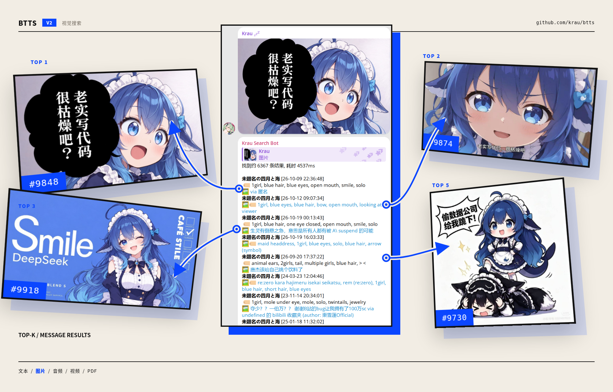

# BTTS

Better Telegram Search, 大概

Demo: [@KrauSearchBot](https://t.me/krausearchbot)

## 特性

- **文字搜索**：支持大部分语种的消息搜索
- **筛选搜索结果**：支持按聊天和消息类型筛选
- **子 bot**：只暴露指定聊天的搜索入口, 适合单个频道或群组
- **Agent**：启用后可以用自然语言直接提问并获取整理后的答案
- **多模态搜索**：支持图片、视频、音频和 PDF



## 使用

### 私聊

直接发送文字即可搜索。直接发送图片，会用这张图片搜索相似消息。

也可以使用：

```
/search 显卡
/ask 帮我找最近的显卡图片
```

`/ask` 默认关闭；不启用时不影响普通搜索。

### 群组

在群组或频道中搜索：

```
/search 关键词
```

回复一张图片并发送 `/search`，会搜索当前聊天中的相似图片消息。

也可以在任意聊天中使用 Inline Query，在输入框中 @bot 即可。

### 管理

```
/add <chat>                添加聊天并自动监听新消息
/add <chat> takeout        用 Takeout 方式导入大频道
/add <chat> noenrich       只做文字搜索，不处理媒体
/addtakeout <chat>         使用 Takeout API 导入
/del <chat>                删除聊天及其已收录内容
```

监听控制：

```
/watch <chat>              开始监听新消息
/unwatch <chat>            停止监听新消息，保留已有内容
/watchdel <chat>           监听消息删除事件
/unwatchdel <chat>         停止监听消息删除事件
```

### 导入历史消息

普通聊天：

```
/add <chat>
```

大频道建议使用：

```
/addtakeout <chat>
```

也可以导入 Telegram Desktop 的 JSON 导出：

```bash
./btts import-tdesktop /path/to/export

# 只导入文字，不处理本地媒体
./btts import-tdesktop /path/to/export --no-media
```

导入可以中断，再次执行会从上次位置继续。

### 媒体处理状态

```
/enrich                    查看处理状态
/enrich retry <id>         重试失败的任务
```

### 单个聊天的媒体检索

```
/enrichable <chat_id>      开启该聊天的媒体检索
/unenrichable <chat_id>    关闭该聊天的媒体检索
```

关闭只影响后续消息，不删除已有内容。

### 子 bot 和 API key

子 bot 只提供搜索能力，并且只能搜索指定聊天：

```
/addsub                    添加子 bot
/delsub                    删除子 bot
/lssub                     列出子 bot
```

子 API key 适合 Web 或第三方调用：

```
/addapikey                 添加子 API key
/delapikey                 删除子 API key
/lsapikey                  列出子 API key
```

### 用户账号插件

~~私货, 不保证可靠性~~

启用 `[plugin] enable = true` 后，在登录账号自己发送的消息中使用命令；默认前缀为 `,`，可以通过 `prefixes` 修改。

- 回复消息后发送 `,re [次数]`：转发消息，可指定次数。
- 在管理员群中发送 `,clean_member`：按提示查找或清理成员。

## 部署

1. 准备搜索服务。BTTS 使用 [Meilisearch](https://www.meilisearch.com/docs/learn/self_hosted/getting_started_with_self_hosted_meilisearch)

```bash
curl -L https://install.meilisearch.com | sh
./meilisearch --master-key 'master-key'
```

2. 在 [Release](https://github.com/krau/btts/releases) 页面下载并解压
3. 创建 `config.toml`，至少填写 Telegram 账号、Bot Token 和搜索服务信息
4. 运行 `./btts`，第一次启动时按提示登录 Telegram 账号

### 最小配置

```toml
app_id = 123
app_hash = "1234567890abcdef1234567890abcdef"
bot_token = "1234567890:ABC-DEF1234ghIkl-zyx57W2v1u123ew11"
admins = [1234567890]

[engine]
type = "meilisearch"
url = "http://127.0.0.1:7700"
key = "master-key"
index = "btts"

[api]
enable = true
addr = "127.0.0.1:39415"
key = "change-me"
```

`[api]` 是可选的。

### 多模态检索

*你需要强劲的服务器硬件*

多模态检索默认关闭。只使用文字搜索时不需要部署本节内容

#### 1. 准备媒体处理服务

- 安装 [Ollama](https://ollama.com/), 并拉取 `embeddinggemma-2` 模型.
- 安装 `ffmpeg` 以支持音频和视频.
- 图片标签(可选)：[konatagger](https://github.com/krau/konatagger)
- PDF(可选)：安装 `pdftotext`，通常来自 `poppler-utils`

#### 2. 配置

把下面的内容追加到已经可以正常运行的 `config.toml` 中：

```toml
[enrich]
enable = true
workers = 2

[enrich.embedder]
enable = true
url = "http://127.0.0.1:11434"
model = "embeddinggemma-2:latest"
dimensions = 768
media_enable = true
video_enable = true
audio_enable = false

[enrich.tagger]
enable = false
url = "http://127.0.0.1:39771"

[enrich.documents]
enable = false
pdftotext = "pdftotext"
```

说明：

- 只需要图片搜索时，保持默认配置即可；
- 需要语音搜索时，把 `audio_enable` 改为 `true`，并确认模型支持音频输入；
- 需要 PDF 搜索时，把 `enrich.documents.enable` 改为 `true`；
- 需要图片标签时，把 `enrich.tagger.enable` 改为 `true`，并确保 tagger 服务地址可访问。

保存配置后重新启动 btts。启动时会检查模型是否可用；如果模型未安装或 Ollama 无法访问，启动会失败并提示原因。

#### 3. 使用

- 新消息会自动处理；
- 已收录的历史消息，需要先 `/del` 再 `/add` 重新导入，才能补齐媒体检索；如果目标聊天消息较多, 这一过程可能会非常慢
- 可以用 `/enrich` 查看处理进度；
- 可以用 `/enrichable` / `/unenrichable` 单独控制聊天

### 完整配置

下面是完整的 `config.toml` 示例。按需修改；不需要的功能保持关闭即可。

```toml
# ===== 基础 =====
app_id = 123
app_hash = "1234567890abcdef1234567890abcdef"
bot_token = "1234567890:ABC-DEF1234ghIkl-zyx57W2v1u123ew11"
admins = [1234567890]

# 日志级别：debug / info / warn / error
client_log_level = "info"

# ===== 用户账号插件 =====
[plugin]
enable = false
prefixes = [","]

# ===== 搜索引擎 =====
[engine]
# 目前使用 meilisearch
type = "meilisearch"
url = "http://127.0.0.1:7700"
# Meilisearch master key
key = "master-key"
# 索引名称
index = "btts"

# ===== OCR（可选） =====
[ocr]
enable = false
type = "paddle"

[ocr.paddle]
url = "http://127.0.0.1:8000/ocr"
threshold = 0.8

# ===== API / Web（可选） =====
[api]
enable = false
addr = "127.0.0.1:39415"
key = "change-me"

# ===== 文件缓存（可选） =====
[file_cache]
disable = false
dir = "data/file_cache"
ttl = "24h"

# ===== 历史导入 =====
[import]
# 命令返回后继续在后台导入
background = true
# 每批历史消息之间的间隔
batch_delay = "1s"

# ===== 媒体增强（可选） =====
[enrich]
enable = false
workers = 2
max_download_mb = 20
max_attempts = 5
retry_backoff = "30s"
wait_index_tasks = true

# 媒体下载与处理限速
media_fetch_per_second = 1
media_fetch_concurrency = 1
media_fetch_retries = 3
flood_wait_extra = "5s"
media_enrich_per_second = 1
media_enrich_concurrency = 1

# 图片/音频查询限速
media_query_per_second = 1
media_query_concurrency = 1

[enrich.embedder]
enable = false
# 媒体索引名称；更换模型或维度时也应更换
media_name = "btts_media"
url = "http://127.0.0.1:11434"
model = "embeddinggemma-2:latest"
dimensions = 768
timeout = "30s"
query_timeout = "10s"
media_enable = true
media_min_score = 0.8
audio_enable = false
video_enable = true
video_frames = 3
warmup = false
num_ctx = 8192

[enrich.tagger]
enable = false
url = "http://127.0.0.1:39771"
token = ""
threshold = 0.4
max_tags = 32
timeout = "5s"

[enrich.documents]
enable = false
pdftotext = "pdftotext"
max_size_mb = 20
max_chars = 12000

# ===== Agent =====
[agent]
enable = false
provider = "gemini"                 # gemini / openai / ollama
model = "gemini-flash-latest"
api_key = ""
base_url = ""
api = "responses"                   # responses / chat_completions
max_llm_calls = 8
max_results = 8
max_concurrency = 2
max_output_tokens = 2048
max_answer_chars = 4000
reasoning_level = "high"
timeout = "90s"
```
